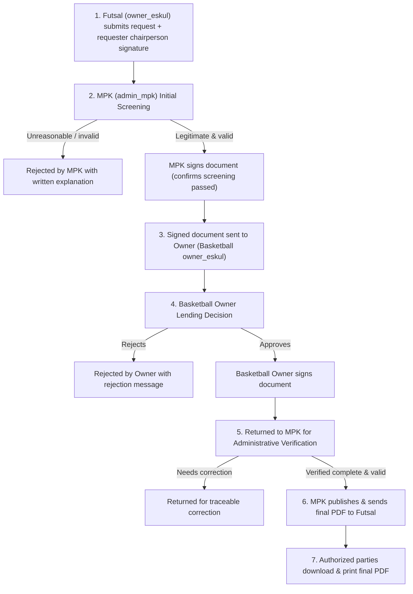
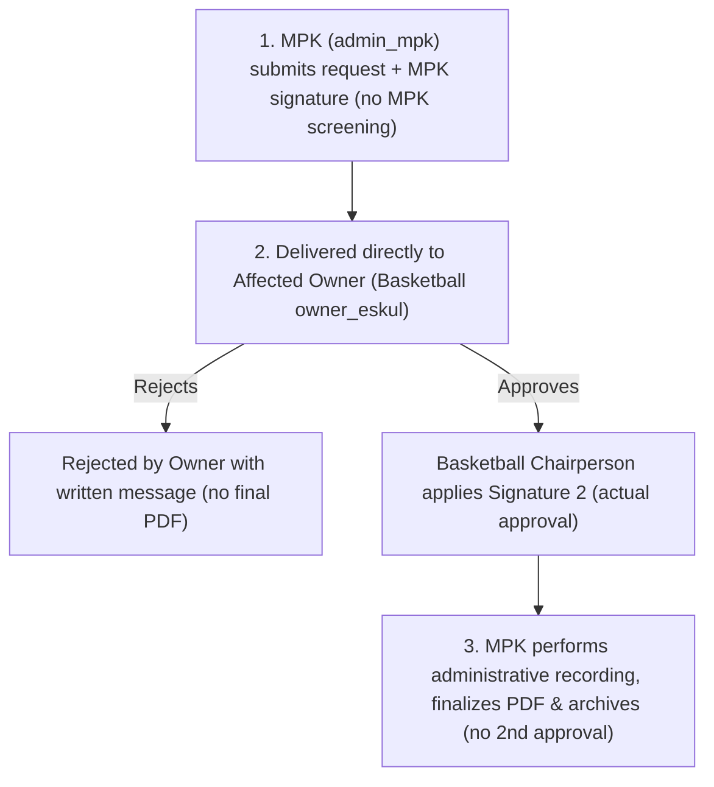

# Coordina — Business Workflow Specification

**Document Date:** 2026-11-25  
**Status:** Finalized MVP Business & Account Model Specification  
**Project:** Coordina (School Extracurricular Scheduling, Borrowing Coordination & Permission Document Platform)  
**Related Docs:** [PROJECT_AUDIT.md](file:///c:/laragon/www/coordina/docs/PROJECT_AUDIT.md) | [DOCUMENT_WORKFLOW.md](file:///c:/laragon/www/coordina/docs/DOCUMENT_WORKFLOW.md)

> **Reading Guide:** Throughout this document, items are explicitly categorized as:
> - **Confirmed Decision** — Agreed business rule for Coordina's intended MVP.
> - **Future Feature Requirement** — Agreed target capability to be built in a later phase (not yet implemented).
> - **Unresolved Question** — Open product/school-policy item requiring clarification prior to implementation.

---

## 1. Project Overview and Business Objectives

Coordina centralizes school facility scheduling, extracurricular (*eskul*) borrowing coordination, and official permission document management between extracurricular organizations and the Student Council (*MPK*, specifically Komisi 2).

### Core Problem Solved
Without a formal system, facility borrowing relies on informal or verbal agreements. For example:
- **Futsal** normally practices on the court on **Monday**.
- **Basketball** normally uses the court on **Friday**.
- Futsal urgently needs the court on **Friday** and informally asks an MPK member, receiving verbal permission without Basketball being consulted or informed.
- Both organizations arrive on Friday expecting exclusive access to the same facility.

### Business Objectives
1. Replace informal/verbal borrowing permissions with a **centralized, structured digital workflow** backed by an official permission letter.
2. Respect **recurring schedule ownership** so an organization's regular practice time cannot be reassigned without its explicit approval and signature.
3. Position **MPK as coordinator, screener, signatory witness, and document verifier**, not an arbitrary second approver bypassing schedule owners.
4. Establish a clean **organizational account model**: one shared MPK account and one organizational account per extracurricular.
5. Provide **transparent decisions** (mandatory written rejection explanations), **full traceability** of every transition and signature, and **automated conflict prevention**.

---

## 2. Core Business Principles *(Confirmed Decisions)*

1. **Organizational Identity:** Accounts represent organizations (MPK or an extracurricular), not individual students.
2. **Schedule Ownership:** Every recurring extracurricular schedule (`fixed_schedules`) has an identifiable owning organization (`organization_id`).
3. **Centralized Coordination:** All inter-extracurricular borrowing requests must pass through MPK.
4. **Owner Decision Authority:** The organization whose recurring schedule is affected makes the actual lending decision (approve or reject).
5. **MPK Screening, Signature & Administrative Verification:**
   - During initial screening, MPK evaluates legitimacy/reasonableness and signs the request document to confirm screening passed.
   - After the schedule owner approves and signs, MPK performs **administrative verification** (completeness, signatures/identities, formatting/integrity) and publishes the final PDF—MPK must **not** arbitrarily override the owner's decision.
6. **Transparent Decisions:** Every rejection (by MPK during screening or by the schedule owner) must include a written explanation.
7. **Traceability:** Every status transition, actor, timestamp, and signature event must be recorded.
8. **Conflict Prevention:** The system must detect and prevent overlapping recurring schedules and overlapping facility bookings.

---

## 3. Account and Role Model *(Confirmed Decision)*

Coordina has **only two intended MVP roles**: `admin_mpk` and `owner_eskul`. There is **no ordinary `user` role** in the intended MVP.

### `admin_mpk` (Shared MPK Account)
- **One shared MPK account** whose credentials are distributed to authorized Komisi 2 members.
- **Responsibilities:**
  - Create and manage extracurricular organizational accounts (`owner_eskul`).
  - Manage facilities, organizations, and recurring schedules (`fixed_schedules`).
  - Manage the master DOCX permission letter template.
  - Perform initial screening of inter-extracurricular requests (Workflow A) and sign accepted requests.
  - Perform final administrative verification of signed documents and publish/send finalized PDFs.
  - Submit MPK borrowing requests (Workflow B) for legitimate school-authority needs.

### `owner_eskul` (Extracurricular Organizational Account)
- **One organizational account per extracurricular** (e.g., *Futsal account*, *Basketball account*, *Volleyball account*).
- Represents the **extracurricular organization** rather than a specific individual; operated by the current extracurricular leader.
- **Responsibilities:**
  - Submit formal borrowing requests on behalf of its organization (including requesting chairperson signature).
  - Receive incoming borrowing requests affecting its organization's recurring schedule (Workflow A and Workflow B).
  - Decide whether to approve or reject lending its schedule (with a written rejection message if rejected, or owner signature if approved).
  - Download and print finalized permission PDFs.

### Exclusion of Legacy `user` Role *(Confirmed Decision)*
- There is **no ordinary `user` role** in the intended MVP account model.
- Individual member accounts are out of scope.

---

## 4. Account Lifecycle *(Future Feature Requirements)*

> **Note:** These account lifecycle capabilities are confirmed **future feature requirements**, not part of current implementation scope.

1. **Account Creation & 1:1 Organization Mapping:** MPK creates and manages extracurricular accounts (one `owner_eskul` account per extracurricular).
2. **Password Generation, Reset & Handover:** MPK can generate a new random password or reset an existing password; newly generated passwords can be copied for secure handover.
3. **Session Revocation on Reset:** Password resets revoke all existing active sessions/tokens for that account.
4. **Leadership Transition & Forced Password Change:** New extracurricular leaders receive the credentials during leadership handover and should be required to change the temporary password on their first login.
5. **Historical Continuity:** Organizational accounts, schedule ownership, borrowing history, and finalized permission documents remain associated with the organization across leadership changes.

---

## 5. Authorization Principles *(Confirmed Decisions)*

1. **`admin_mpk` Authority:** Manages organizational accounts, facilities, fixed schedules, master templates, borrowing screening, and final administrative document verification.
2. **Organization-Scoped Authority (`owner_eskul`):** Acts strictly on behalf of its own organization (`user.organization_id`).
3. **Borrowing & Lending Rights:** Can submit requests for its own organization and decide/sign requests affecting its own recurring schedule.
4. **Cross-Organization Isolation:** An extracurricular account must never view, sign, or decide requests belonging to another organization's schedule (unless it is the requesting organization for that request).
5. **No `user` Role:** Ordinary `user` accounts are not part of the intended MVP and hold no permissions.
6. **Non-Bypassable Workflow:** No role may skip screening, forge/skip required signatures, or overturn the schedule owner's lending decision.

---

## 6. Recurring Schedule Ownership

- A recurring schedule (`fixed_schedules`) binds a **facility** (`facility_id`), a **day of the week** (`day`), and a **time window** (`start_time`–`end_time`) to an **owning organization** (`organization_id`).
- When a borrowing request is submitted, the system resolves the weekday of `date` and checks overlapping `fixed_schedules` on that `facility_id` and `day`:
  - **Owned Slot:** Overlapping schedule's `organization_id` becomes `owner_organization_id`, requiring that owner's approval and signature.
  - **Unowned / Free Slot:** If no recurring schedule overlaps, `owner_organization_id` is `null` *(see Section 12 for open questions on free-slot letter requirements)*.

---

## 7. Borrowing Workflows *(Confirmed Decisions)*

### Workflow A: Inter-Extracurricular Borrowing

**Example:** Futsal requests to borrow Basketball's regular Friday schedule.

1. **Request Submission (`owner_eskul` — Futsal):**
   - Futsal submits a request containing: borrowing reason, requested date, time, facility, requesting organization, affected schedule owner (Basketball), and **requesting organization's chairperson signature**.
2. **MPK Initial Screening (`admin_mpk`):**
   - MPK evaluates the legitimacy and reasonableness of the request.
   - **If unreasonable/rejected:** Process ends; MPK provides a written explanation.
   - **If accepted:** MPK **signs the request document** (confirming screening passed).
3. **Forwarding to Affected Owner:**
   - The MPK-signed document is sent to the affected extracurricular organization (Basketball).
4. **Schedule Owner Decision (`owner_eskul` — Basketball):**
   - Basketball makes the actual lending decision:
   - **If rejected:** Process stops and Basketball provides a rejection message.
   - **If approved:** Basketball **signs the document**.
5. **MPK Administrative Verification (`admin_mpk`):**
   - The signed document returns to MPK for **administrative verification**:
     - Document completeness.
     - Signatures and identities.
     - Document integrity and formatting.
   - *Crucial Rule:* This is **NOT** another substantive approval stage. MPK cannot arbitrarily override the schedule owner's decision.
6. **Publication & Delivery:**
   - If verification succeeds, MPK publishes and sends the final document to the requesting organization (Futsal).
   - *(If verification uncovers missing/broken document elements, it enters correction; see [DOCUMENT_WORKFLOW.md](file:///c:/laragon/www/coordina/docs/DOCUMENT_WORKFLOW.md).)*
7. **Download & Print:**
   - Authorized parties can download the final official permission letter as PDF and print it.

---

### Workflow B: MPK Borrowing an Extracurricular Schedule

**Example:** An official school-authorized event requires Basketball's regular Friday court slot.

1. **Request Submission & MPK Signature (`admin_mpk` as Requester):**
   - MPK submits the borrowing request directly to the affected extracurricular organization (Basketball) and applies **Signature 1 (MPK Representative)** as the requesting party.
   - **No separate MPK initial screening stage** exists because MPK is the requester.
2. **Schedule Owner Decision & Signature (`owner_eskul` — Basketball):**
   - Basketball decides whether to approve or reject lending its schedule.
   - **If rejected:** Process stops and Basketball provides a written rejection message (no final PDF generated).
   - **If approved:** Basketball applies **Signature 2 (Affected Extracurricular Chairperson)**, which represents the **actual approval**.
3. **Administrative Recording & Final Document Handling (`admin_mpk`):**
   - **No third signature** and **no second approval** occur after the owner signs.
   - MPK performs administrative recording, final document handling/packaging, and archives/publishes the finalized PDF (and updates the official schedule).

---

## 8. High-Level Status Lifecycle & Authority Matrix

> For granular document, signature, and verification states, see [DOCUMENT_WORKFLOW.md](file:///c:/laragon/www/coordina/docs/DOCUMENT_WORKFLOW.md#e-document-lifecycle).

### Business & Document State Mapping
- **Current Codebase:** Uses four flat statuses (`pending_mpk`, `pending_owner`, `approved`, `rejected`) with no signature, verification, or correction states.
- **Intended Workflow A Lifecycle (3 Signatures):**
  `Draft / Request Submitted` → `Waiting for MPK Screening` → (`Rejected by MPK` | `Waiting for MPK Signature`) → `Waiting for Schedule Owner` → (`Rejected by Schedule Owner` | `Waiting for Owner Signature`) → `Returned to MPK for Verification` → (`Needs Correction` | `Finalized / Published`).
- **Intended Workflow B Lifecycle (2 Signatures):**
  `Draft / Request Submitted` (with MPK Signature 1) → `Waiting for Schedule Owner` → (`Rejected by Schedule Owner` | `Waiting for Owner Signature`) → `Returned to MPK for Administrative Recording` → `Finalized / Published`.
- **Rejection Rule:** Any rejected request (`Rejected by MPK` or `Rejected by Schedule Owner`) must **never** generate a finalized permission PDF, while its request history and rejection messages remain stored.

### Authority Matrix *(Confirmed Decisions)*

| Action | `admin_mpk` (Shared Account) | `owner_eskul` (Affected Owner) | `owner_eskul` (Requester / Other) |
|---|---|---|---|
| Manage `owner_eskul` accounts, templates, facilities, fixed schedules | **Yes** | No | No |
| Submit Workflow A request + requester chairperson signature | Not applicable (uses Workflow B) | Yes (for own org) | Yes (for own org) |
| Submit Workflow B request + MPK signature | **Yes** | No | No |
| Screen Workflow A request + apply MPK signature | **Yes** | No | No |
| Approve/reject `Waiting for Schedule Owner` + apply owner signature | **No** *(must not bypass owner)* | **Yes** (own schedule only) | No |
| Verify Workflow A signed document / record Workflow B & publish final PDF | **Yes** (administrative only; no second approval) | No | No |
| Download & print finalized PDF | **Yes** | **Yes** (involved org) | **Yes** (if requester) |

---

## 9. Rejection Reasons, Notifications & Conflict Prevention

- **Written Rejection Explanations:** Mandatory for both MPK screening rejections and schedule owner rejections, preserved in history and shown to the requester.
- **Communication & Visibility:** Requester organizations must be able to track request status, signature progress, rejection messages, and download/print finalized PDFs.
- **Schedule Conflict Prevention:** The system must prevent overlapping `fixed_schedules`, prevent overlapping `borrow_requests` against `approved` bookings (using atomic transactions/locks at finalization), validate `end_time > start_time` and non-past dates, and handle multi-owner overlaps explicitly.

---

## 10. Technical Implications *(Codebase vs. Intended Model)*

1. **Legacy `user` Role References:**
   - [BorrowRequestController.php](file:///c:/laragon/www/coordina/backend/app/Http/Controllers/BorrowRequestController.php#L94-L105) checks `$user->role === 'user'` for owner approval (blocking `owner_eskul`) and has a `null === null` bypass + data leak (`lines 67-70`).
   - [UserController.php](file:///c:/laragon/www/coordina/backend/app/Http/Controllers/UserController.php#L19-L86) only queries, creates, and deletes `role = 'user'`.
   - [DatabaseSeeder.php](file:///c:/laragon/www/coordina/backend/database/seeders/DatabaseSeeder.php#L62-L70) seeds `siswa@sekolah.com` (`user`) and omits `organization_id` on all seeded users.
2. **Organization / Account Relationships:**
   - `users.organization_id` has no uniqueness constraint enforcing 1:1 mapping per organization.
   - `User` lacks an `organization()` relationship; `Organization` lacks `users()`, `fixedSchedules()`, `borrowRequests()`, and profile/signature asset fields (logo, chairperson name/title/ID, signature image).
3. **Safe Database Migration Considerations:**
   - Do **not** destructively drop `year`, `major`, `class`, or the `user` enum value prematurely. Migrate existing organizational rows (`role = 'user'` with `organization_id`) safely to `owner_eskul`, keep legacy columns nullable/deprecated, and enforce the two-role model at the authorization/policy layer before any schema cleanup.
   - Add additive tables/columns for organizational branding/signature assets, document templates, signature audit events, verification/correction history, `workflow_type`, and future password-lifecycle fields (`must_change_password`, `password_changed_at`).
4. **Frontend Adjustments ([dashboard.vue](file:///c:/laragon/www/coordina/frontend/app/pages/dashboard.vue)):**
   - Remove the non-existent `'admin'` check; update account management for `owner_eskul`; add requester status tracking, mandatory rejection reason inputs, signature confirmation actions, MPK verification/template controls, and PDF download/print views.

---

## 11. Edge Cases & Unresolved Business Questions

### Edge Cases
- Legacy `user` records in existing databases during transition.
- `owner_eskul` requesting a slot its own organization already owns.
- Pending requests whose `date` expires before screening/owner decision/verification finishes.
- Leadership transitions occurring mid-flight while a request is awaiting signature or verification.

### Unresolved Questions *(Require Clarification Before Implementation)*
1. **Free / Unowned Slot Letter Requirement:** When a request targets a time slot with no `fixed_schedules` owner (`owner_organization_id = null`), does it still require an official permission letter (e.g., 2 signatures: Requester + MPK), or is a simpler approval sufficient?
2. **Workflow B School-Authority Verification:** How should legitimate school-authority MPK requests be substantiated (e.g., mandatory supporting memo upload `document_path` or `priority = 'high'`)?
3. **Concurrent Pending Requests:** Should overlapping pending requests for the same slot be blocked at submission time, or allowed until the first is finalized/approved?
4. **Spanning Multiple Fixed Schedules:** If one request overlaps two different organizations' fixed schedules, should it be rejected, split, or require consent/signatures from both owners?
5. **Post-Approval Cancellation:** Can a finalized/approved booking be cancelled, by whom, and how is the published PDF marked void/revoked?
