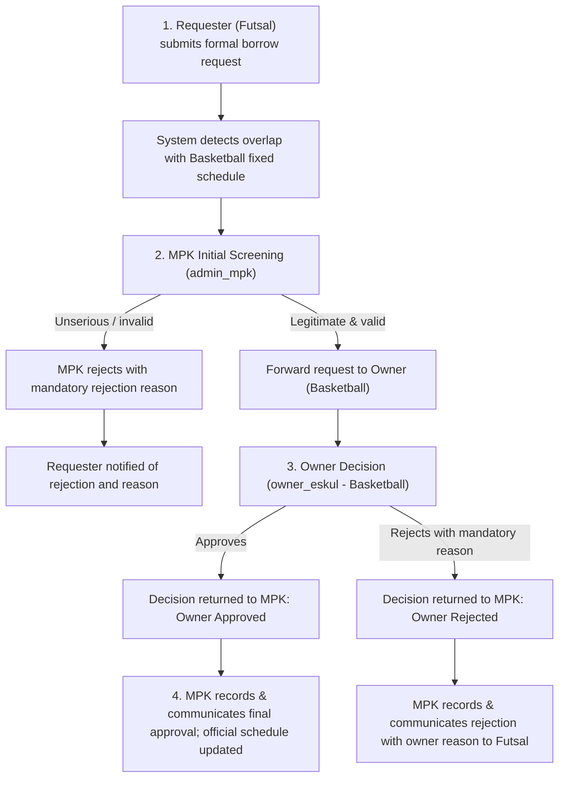
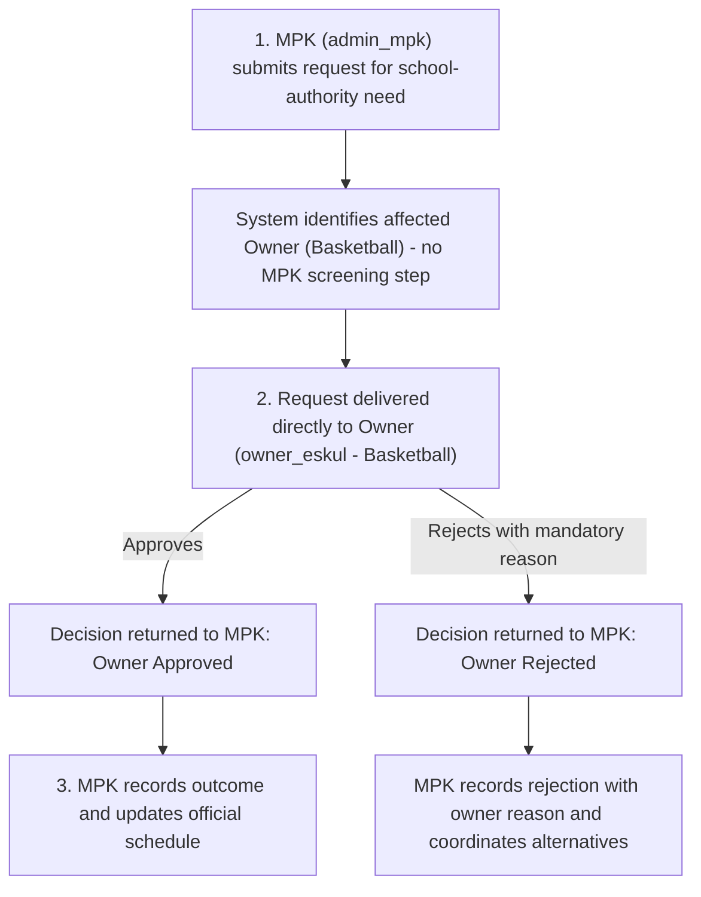

# Coordina — Business Workflow Specification

**Document Date:** 2026-11-25  
**Project:** Coordina (School Extracurricular Scheduling & Facility Borrowing Platform)  
**Reference:** [PROJECT_AUDIT.md](file:///c:/laragon/www/coordina/docs/PROJECT_AUDIT.md)

---

## 1. Project Overview and Business Objectives

Coordina centralizes school facility scheduling and extracurricular (*eskul*) borrowing coordination between extracurricular organizations and the Student Council (*MPK*, e.g., Komisi 2).

### Core Problem Solved
Without a formal system, facility borrowing relies on informal or verbal agreements. For example:
- **Futsal** normally practices on the court on **Monday**.
- **Basketball** normally uses the court on **Friday**.
- Futsal urgently needs the court on **Friday** and informally asks an MPK member, receiving verbal permission without Basketball being consulted or informed.
- Both organizations arrive on Friday expecting exclusive access to the same facility.

### Business Objectives
1. Replace informal/verbal borrowing permissions with a **centralized, structured digital workflow**.
2. Respect **recurring schedule ownership** so an organization's regular practice time cannot be reassigned without consulting its authorized owner.
3. Position **MPK as coordinator, screener, and record-keeper**, not an arbitrary approver bypassing schedule owners.
4. Provide **transparent decisions** (mandatory rejection reasons), **full traceability** of every transition, and **automated conflict prevention**.

---

## 2. Core Business Principles

1. **Schedule Ownership:** Every recurring extracurricular schedule (`fixed_schedules`) has an identifiable owning organization (`organization_id`).
2. **Centralized Coordination:** All inter-extracurricular borrowing requests must pass through MPK.
3. **Owner Decision Authority:** The organization whose recurring schedule is affected makes the actual lending decision (approve or reject).
4. **MPK as Mediator:** MPK screens inter-organization requests for legitimacy, forwards valid requests to the owner, receives the owner's decision, and records/communicates the official outcome. MPK must not arbitrarily overturn the schedule owner's decision.
5. **Transparent Decisions:** Every rejection (whether at MPK screening or by the schedule owner) must include a clear rejection reason.
6. **Traceability:** Every status transition, actor, timestamp, and reason must be recorded so no permission is informal or untraceable.
7. **Conflict Prevention:** The system must detect and prevent overlapping recurring schedules and overlapping facility bookings.

---

## 3. Roles and Responsibilities

The database `users.role` enum defines three roles: `admin_mpk`, `owner_eskul`, and `user`.

### `admin_mpk` (MPK Administration / Komisi 2)
Represents the authorized MPK administrators overseeing extracurricular coordination.
- **Responsibilities:**
  - Receive incoming borrowing requests.
  - Perform initial screening of inter-extracurricular requests (rejecting unserious, joke, or clearly illegitimate requests with a reason).
  - Forward screened requests to the affected schedule owner (`owner_eskul`).
  - Receive the owner's decision and perform final administrative recording and communication to the requester.
  - Submit MPK borrowing requests (Workflow B) when an official school-authorized need requires an extracurricular's regular time slot.
  - Manage facilities, organizations, recurring schedules (`fixed_schedules`), and authorized organization accounts.

### `owner_eskul` (Extracurricular Schedule Owner / Representative)
Represents the person authorized to speak and decide for an extracurricular organization (`user.organization_id`).
- **Responsibilities:**
  - Represent their organization's recurring schedules and submit formal borrowing requests on behalf of their organization.
  - Receive borrowing requests (both Workflow A and Workflow B) that overlap their organization's recurring schedule.
  - Evaluate and officially **approve** or **reject** lending their time slot.
  - Provide a mandatory reason when rejecting a request.

### `user` (Ordinary User)
Represents an ordinary member or general user account.
- **Evaluation Against Current Implementation:**
  - Currently, `UserController.php` creates organization accounts with `role = 'user'`, `BorrowRequestController::updateStatus()` grants approval authority to `role = 'user'` (while locking out `owner_eskul`), and `DatabaseSeeder.php` creates `siswa@sekolah.com` (`user`) and `ketua@basket.com` (`owner_eskul`) without `organization_id`.
- **Intended Business Rule:**
  - An ordinary `user` **must not** have administrative authority or the authority to approve/reject borrowing requests affecting an organization's schedule.
  - Unless an explicit future business requirement defines read-only member access or requester-only submission under supervision, `user` must be restricted from all approval and admin actions.

---

## 4. Recurring Schedule Ownership

- A recurring schedule (`fixed_schedules`) binds a **facility** (`facility_id`), a **day of the week** (`day`), and a **time window** (`start_time`–`end_time`) to an **owning organization** (`organization_id`).
- When a borrowing request is submitted for a facility, date, and time:
  - The system resolves the weekday of `date` and checks whether it overlaps any `fixed_schedules` entry on that `facility_id` and `day`.
  - **Owned Slot:** If a recurring schedule overlaps, that schedule's `organization_id` is the **affected schedule owner** (`owner_organization_id`), requiring the owner's lending decision.
  - **Unowned / Free Slot:** If no recurring schedule overlaps (and no other approved booking exists), there is no schedule owner (`owner_organization_id` is `null`); MPK coordinates directly *(see Section 12 for open questions on free-slot requests)*.

---

## 5. Borrowing Workflows

### Workflow A: Inter-Extracurricular Borrowing

**Scenario:** Futsal wants to borrow Basketball's regular Friday court schedule.

1. **Request Submission (Requester — Futsal):**
   - Futsal submits a formal borrowing request specifying the facility, date, start/end time, reason, and required supporting details.
   - The system detects that Friday's slot overlaps Basketball's recurring schedule (`owner_organization_id = Basketball`).
2. **MPK Initial Screening (`admin_mpk`):**
   - Request enters MPK's screening queue.
   - MPK checks whether the request is reasonable, legitimate, and relevant (filtering out unserious or joke submissions).
   - **If rejected by MPK:** MPK records a mandatory rejection reason; workflow ends as rejected and requester is informed.
   - **If passed screening:** MPK forwards the request to the affected schedule owner (Basketball).
3. **Schedule Owner Decision (`owner_eskul` — Basketball):**
   - Basketball receives the forwarded request and decides whether to lend its Friday slot.
   - **If approved by Owner:** Decision returns to MPK for administrative processing.
   - **If rejected by Owner:** Basketball provides a mandatory rejection reason; decision returns to MPK.
4. **MPK Administrative Processing (`admin_mpk`):**
   - MPK records the owner's decision and communicates the official outcome to Futsal.
   - If Basketball approved, MPK processes/finalizes the request as **approved** (updating the official schedule).
   - If Basketball rejected, MPK records/communicates the **rejection and Basketball's reason**.
   - **Constraint:** MPK's final step is administrative coordination and communication—MPK must **not** arbitrarily approve a request that the schedule owner rejected or bypass owner consent.

---

### Workflow B: MPK Borrowing an Extracurricular Schedule

**Scenario:** An authorized school event needs the court during Basketball's regular Friday practice slot, and MPK needs to request that time slot.

1. **Request Submission (`admin_mpk` as Requester):**
   - MPK submits the borrowing request directly to the affected extracurricular organization (Basketball), specifying the facility, date, time, and school-authority justification.
   - **No separate MPK initial screening stage** occurs because MPK itself is the requester.
2. **Schedule Owner Decision (`owner_eskul` — Basketball):**
   - Basketball receives MPK's request directly.
   - Basketball evaluates whether it can yield its schedule and either **approves** or **rejects** (with a mandatory rejection reason).
3. **MPK Administrative Processing (`admin_mpk` as Coordinator):**
   - The owner's decision returns to MPK.
   - MPK records the outcome and coordinates the schedule impact (updating the official schedule if approved, or accepting/coordinating alternatives if rejected).

**Key Distinctions:**
- MPK acts as **both requester and coordinating intermediary**.
- There is **no self-screening step**.
- The extracurricular organization (`owner_eskul`) **retains lending decision authority**.
- Intended strictly for **legitimate school-authority needs**—ordinary MPK activities must not be assumed to automatically override extracurricular schedules.

---

## 6. Status Lifecycle and Transition Rules

> **Note:** The current codebase only uses four flat strings (`pending_mpk`, `pending_owner`, `approved`, `rejected`) and lacks intermediate states (`owner_approved` / `owner_rejected`) needed to return the owner's decision to MPK for administrative recording.

### Target Status Definitions

| Status | Meaning | Applicable Workflows |
|---|---|---|
| `pending_mpk_screening` *(currently `pending_mpk`)* | Submitted by an organization; awaiting MPK initial screening. | Workflow A (and unowned-slot requests) |
| `pending_owner` | Forwarded to (Workflow A) or directly submitted to (Workflow B) the affected `owner_eskul`; awaiting owner decision. | Workflow A & B |
| `owner_approved` *(missing in current code)* | Schedule owner approved; returned to MPK for administrative recording and requester notification. | Workflow A & B |
| `owner_rejected` *(missing in current code)* | Schedule owner rejected with reason; returned to MPK for administrative recording and requester notification. | Workflow A & B |
| `approved` | Finalized/recorded by MPK after owner approval (or direct MPK approval for unowned free slots); reflected on the official schedule. | Workflow A, B, & Free Slots |
| `rejected` | Finalized rejection (either rejected at MPK screening or finalized after `owner_rejected`), with mandatory `rejection_reason`. | Workflow A, B, & Free Slots |

### Allowed State Transitions

| From Status | To Status | Permitted Actor | Condition |
|---|---|---|---|
| *(new)* | `pending_mpk_screening` | Requester (`owner_eskul` / authorized org representative) | Workflow A (or unowned slot) |
| *(new)* | `pending_owner` | `admin_mpk` | Workflow B (MPK borrowing an owned slot) |
| `pending_mpk_screening` | `pending_owner` | `admin_mpk` | Affected `owner_organization_id` is not null; passes screening |
| `pending_mpk_screening` | `approved` | `admin_mpk` | Only when `owner_organization_id` is null (unowned free slot) and no conflicts exist |
| `pending_mpk_screening` | `rejected` | `admin_mpk` | Mandatory `rejection_reason` provided |
| `pending_owner` | `owner_approved` | `owner_eskul` (where `user.organization_id === owner_organization_id`) | Owner agrees to lend slot |
| `pending_owner` | `owner_rejected` | `owner_eskul` (where `user.organization_id === owner_organization_id`) | Mandatory `rejection_reason` provided |
| `owner_approved` | `approved` | `admin_mpk` | Administrative finalization + conflict check |
| `owner_rejected` | `rejected` | `admin_mpk` | Administrative finalization preserving owner's `rejection_reason` |

*Terminal states:* `approved` and `rejected` (unless a future cancellation workflow is added).

---

## 7. Approval and Rejection Authority Matrix

| Action | `admin_mpk` | `owner_eskul` (Affected Owner) | `owner_eskul` (Other / Requester) | `user` (Ordinary Member) |
|---|---|---|---|---|
| Submit Workflow A request | Not applicable (uses Workflow B if requesting) | Yes (for own org) | Yes (for own org) | **No** *(unless explicitly permitted by school policy)* |
| Submit Workflow B request | Yes | No | No | No |
| Screen Workflow A request (forward / reject) | **Yes** | No | No | No |
| Approve / reject `pending_owner` request | **No** *(must not bypass owner)* | **Yes** (own org's schedule only) | No | **No** |
| Record/finalize `owner_approved` / `owner_rejected` | **Yes** (administrative only; cannot flip owner rejection to approved) | No | No | No |
| Approve unowned free-slot request | **Yes** | No | No | No |
| Manage facilities & `fixed_schedules` | **Yes** | No | No | No |

---

## 8. Required Information for Each Borrowing Request

| Field | Business Purpose | Current Schema (`borrow_requests`) | Current API / UI Status |
|---|---|---|---|
| Requesting User (`user_id`) | Traceability of individual submitter | Exists (`NOT NULL`) | Set from `$request->user()->id` |
| Requesting Organization (`organization_id`) | Identifies borrowing eskul (or MPK org in Workflow B) | Exists (`NOT NULL`) | **Gap:** Fails SQL if user has `organization_id = null` |
| Facility (`facility_id`) | Target facility | Exists (`NOT NULL`) | Implemented |
| Target Date (`date`) | Specific calendar date of borrowing | Exists (`date`) | Implemented (missing future-date check) |
| Time Window (`start_time`, `end_time`) | Requested start and end times | Exists (`time`) | Implemented (missing `end_time > start_time` check) |
| Affected Owner (`owner_organization_id`) | Owning organization of overlapping fixed schedule | Exists (`nullable`) | Derived via `FixedSchedule` overlap |
| Reason (`reason`) | Formal justification for borrowing | Exists (`text`) | Implemented |
| Request Type / Workflow (`workflow_type`) | Distinguishes Workflow A vs. Workflow B | **Missing** | Not implemented |
| Priority (`priority`) | Urgency / school-event priority indicator | Exists (`low`/`medium`/`high`) | Unused in `$fillable`, API, and UI |
| Supporting Document (`document_path`) | Optional/required letter or event memo | Exists (`nullable`) | Unused in `$fillable`, API, and UI |
| Rejection Reason (`rejection_reason`) | Mandatory explanation when rejected | Exists (`nullable`) | Unused in `$fillable`, API, and UI |

---

## 9. Rejection Reason Requirements

- **Mandatory on All Rejections:**
  - When `admin_mpk` rejects a request during Workflow A screening (`pending_mpk_screening` → `rejected`), `rejection_reason` must be non-empty.
  - When `owner_eskul` rejects a request (`pending_owner` → `owner_rejected`), `rejection_reason` must be non-empty.
- **Preservation & Visibility:**
  - MPK must pass the owner's `rejection_reason` transparently to the requester without erasing or altering the owner's rationale.
  - The requester must be able to view the `rejection_reason` and see which stage rejected the request (MPK screening vs. Schedule Owner).

---

## 10. Notification and Communication Expectations

To eliminate informal side-channel misunderstandings, users must be proactively informed of status changes:
1. **On Workflow A Submission:** `admin_mpk` sees the new request in the screening queue; requester sees `pending_mpk_screening`.
2. **On Screening Rejection:** Requester is notified of rejection + MPK's reason.
3. **On Forwarding (or Workflow B Submission):** Affected `owner_eskul` is notified of the pending request affecting their schedule; requester sees `pending_owner`.
4. **On Owner Decision:** `admin_mpk` is notified that the owner responded (`owner_approved` or `owner_rejected`).
5. **On Final Recording:** Requester (and owner, for confirmation) receives official confirmation of `approved` (with schedule update) or `rejected` (with reason).

*(Current Gap: Neither in-app/email/WebSocket notifications nor a requester-facing "My Requests" status list exist today.)*

---

## 11. Schedule Conflict Prevention Requirements

The system must prevent double-booking across all schedule layers:
1. **Fixed Schedule vs. Fixed Schedule:** Reject creating a `fixed_schedules` entry that overlaps an existing `fixed_schedules` entry on the same `facility_id` and `day`.
2. **Borrow Request vs. Approved Borrow Requests:** Reject creating or approving a `borrow_requests` entry that overlaps an existing `approved` request on the same `facility_id` and `date`.
3. **In-Flight Request Awareness:** Warn or block overlapping pending requests (`pending_mpk_screening`, `pending_owner`, `owner_approved`) for the same slot, and enforce an atomic conflict check inside `DB::transaction()` with row locking at finalization.
4. **Multi-Owner Overlap Handling:** If a borrow request spans a time window touching more than one `fixed_schedules` entry, the system must either reject multi-owner spanning requests or require consent from every affected owner (not silently pick `->first()`).
5. **Time & Date Validity:** Require `end_time > start_time` and prevent past-date bookings.

---

## 12. Edge Cases and Unresolved Business Questions

### Edge Cases
- **Requester without `organization_id`:** E.g., `admin_mpk` submitting Workflow B if `admin@mpk.com` has no `organization_id` linked to `MPK / OSIS`.
- **Self-Borrowing:** An eskul submitting a request for a slot it already owns in `fixed_schedules`.
- **Expired / Past-Date Pending Requests:** A `pending_mpk_screening` or `pending_owner` request whose `date` has already passed before a decision is made.
- **Cancellation / Withdrawal:** Requester wanting to cancel a pending or already-approved request.
- **Unowned (Free) Slots:** Borrowing a facility at a time with no `fixed_schedules` entry (`owner_organization_id = null`).

### Unresolved Business Questions (Require Clarification Before Implementation)
1. **Ordinary `user` Role Scope:** Should `role = 'user'` be allowed to submit borrow requests on behalf of an organization (requiring `organization_id`), or are *only* `owner_eskul` and `admin_mpk` allowed to submit requests, with `user` strictly read-only?
2. **Automatic vs. Manual MPK Final Step:** When `owner_eskul` approves (`owner_approved`), does `admin_mpk` click a confirmation button to record/publish (`approved`), or should the system record the owner approval automatically while notifying MPK? (Similarly for `owner_rejected` → `rejected`.)
3. **Workflow B School-Authority Verification:** How should the system distinguish legitimate school-authority MPK requests (Workflow B) from ordinary MPK activities—via a mandatory document upload (`document_path`), `priority = 'high'`, or advisor/school-official note?
4. **Concurrent Pending Requests:** Should two organizations be blocked from submitting *pending* requests for the same slot at the same time, or may both stay pending until the first one is approved (auto-rejecting or blocking the other)?
5. **Spanning Multiple Fixed Schedules:** If a requested time window overlaps two different organizations' fixed schedules back-to-back, should the request be split, rejected, or require multi-owner approval?
6. **Cancellation Rules:** Can a requester cancel an `approved` booking, and if so, does the slot automatically revert to the original `fixed_schedules` owner?

---

## 13. Intended Workflow vs. Current Implementation

| Aspect | Intended Business Workflow | Current Implementation | Code Reference |
|---|---|---|---|
| **Role Authority (`owner_eskul` vs `user`)** | `owner_eskul` approves/rejects affected slots; `user` has no approval rights | `owner_eskul` is blocked (`403`); ordinary `user` can update `pending_owner` requests | [BorrowRequestController.php:94-105](file:///c:/laragon/www/coordina/backend/app/Http/Controllers/BorrowRequestController.php#L94-L105) |
| **MPK Final Step** | Owner decision returns to MPK for recording/communication; MPK cannot arbitrarily bypass owner | `owner` sets status directly to `'approved'` (bypassing MPK), OR MPK can set `'approved'` directly (bypassing owner) | [BorrowRequestController.php:86-105](file:///c:/laragon/www/coordina/backend/app/Http/Controllers/BorrowRequestController.php#L86-L105), [dashboard.vue:497-542](file:///c:/laragon/www/coordina/frontend/app/pages/dashboard.vue#L497-L542) |
| **Workflow B (MPK Borrowing)** | MPK submits directly to `owner_eskul` without self-screening | `store()` forces `status = 'pending_mpk'` for all users; `admin@mpk.com` has `organization_id = null` (SQL 500) | [BorrowRequestController.php:34-44](file:///c:/laragon/www/coordina/backend/app/Http/Controllers/BorrowRequestController.php#L34-L44), [DatabaseSeeder.php:40-48](file:///c:/laragon/www/coordina/backend/database/seeders/DatabaseSeeder.php#L40-L48) |
| **Status Validation & Null Guard** | Strict state machine transitions; strict `organization_id` matching | Accepts any string for `status`; `null === null` lets org-less `user`s alter `null`-owner requests; `index()` leaks `null`-owner requests | [BorrowRequestController.php:67-99](file:///c:/laragon/www/coordina/backend/app/Http/Controllers/BorrowRequestController.php#L67-L99) |
| **Rejection Reasons** | Mandatory `rejection_reason` on every rejection | Column exists in migration, ignored in `$fillable`, controller, and UI | [BorrowRequest.php:12-15](file:///c:/laragon/www/coordina/backend/app/Models/BorrowRequest.php#L12-L15), [dashboard.vue:414-420](file:///c:/laragon/www/coordina/frontend/app/pages/dashboard.vue#L414-L420) |
| **Conflict Detection** | Prevent overlapping fixed schedules and overlapping borrow requests | Only checks `FixedSchedule::first()`; ignores overlapping `BorrowRequest`s and overlapping `FixedSchedule`s | [BorrowRequestController.php:26-32](file:///c:/laragon/www/coordina/backend/app/Http/Controllers/BorrowRequestController.php#L26-L32), [FixedScheduleController.php:11-28](file:///c:/laragon/www/coordina/backend/app/Http/Controllers/FixedScheduleController.php#L11-L28) |
| **Traceability & Notifications** | Full transition history + notifications + requester status visibility | No audit table; no notifications; non-admin UI cannot see its own submitted requests | [dashboard.vue:485-520](file:///c:/laragon/www/coordina/frontend/app/pages/dashboard.vue#L485-L520) |
| **Official Schedule Display** | Approved overrides shown on their exact date without colliding across weeks | Grouped by weekday name only (`getDayName(req.date)`) without displaying `req.date` | [dashboard.vue:453-476](file:///c:/laragon/www/coordina/frontend/app/pages/dashboard.vue#L453-L476) |

---

## 14. Implementation Recommendations (Backend & Frontend)

### Backend Recommendations
1. **Introduce Explicit State Machine & Policy:**
   - Create a `BorrowRequestPolicy` and a dedicated `BorrowRequestService` enforcing Workflow A and Workflow B transitions (`pending_mpk_screening` → `pending_owner` → `owner_approved`/`owner_rejected` → `approved`/`rejected`).
   - Fix role checks to authorize `owner_eskul` (with non-null `organization_id` matching `owner_organization_id`) and deny approval rights to `user`.
2. **Schema & Audit Trail Additions:**
   - Add `workflow_type` (`inter_eskul`, `mpk_borrow`) to `borrow_requests`, add `rejection_reason`, `priority`, `document_path` to `BorrowRequest::$fillable`, and create an `approval_histories` (or `borrow_request_logs`) table recording `actor_id`, `from_status`, `to_status`, `note`, and `created_at`.
   - Ensure `admin@mpk.com` is linked to the `MPK / OSIS` organization in `DatabaseSeeder.php` so Workflow B has a valid `organization_id`.
3. **Conflict Detection & Locking:**
   - Wrap creation and approval in `DB::transaction()`, check `FixedSchedule` and `BorrowRequest` overlaps, validate `end_time > start_time` and `date >= today`, and handle multi-owner overlaps explicitly.
4. **Notifications:**
   - Dispatch Laravel Notifications (database channel + optional Reverb broadcast) on every workflow transition.

### Frontend Recommendations
1. **Role-Specific Views in Dashboard:**
   - **Requester View (`owner_eskul` / authorized submitter):** Add a **"My Borrow Requests"** list displaying current status, workflow stage, and `rejection_reason`.
   - **Owner Inbox (`owner_eskul`):** Show both Workflow A and Workflow B incoming `pending_owner` requests, require a rejection reason in the modal before rejecting, and submit `owner_approved` / `owner_rejected` (not final `approved`).
   - **MPK Workbench (`admin_mpk`):** Separate **Screening Queue** (`pending_mpk_screening`), **Awaiting Owner** (`pending_owner`), **Ready to Finalize/Record** (`owner_approved` / `owner_rejected`), and a **Workflow B Borrow Form**.
2. **Schedule Calendar Accuracy:**
   - Include Saturday/Sunday tabs and show the exact calendar date (`req.date`) on approved overrides and extra bookings (ideally filtering by selected week).

