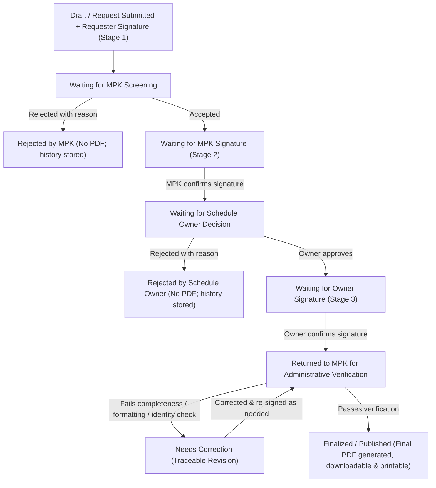

# Coordina — Document & Signature Workflow Specification

**Document Date:** 2026-11-25  
**Status:** Draft Specification (Confirmed Requirements + Proposed Technical Lifecycle)  
**Project:** Coordina (School Extracurricular Scheduling, Borrowing Coordination & Permission Document Platform)  
**Related Docs:** [BUSINESS_WORKFLOW.md](file:///c:/laragon/www/coordina/docs/BUSINESS_WORKFLOW.md) | [PROJECT_AUDIT.md](file:///c:/laragon/www/coordina/docs/PROJECT_AUDIT.md)

> **Inspection Note:** A workspace scan confirmed there is currently **no DOCX template example file** in the repository, and no DOCX/PDF generation library is installed in [composer.json](file:///c:/laragon/www/coordina/backend/composer.json). Existing infrastructure only includes `borrow_requests.document_path` (unused) and Laravel filesystem disks in [filesystems.php](file:///c:/laragon/www/coordina/backend/config/filesystems.php).

---

## 1. Purpose & Scope

In Coordina, facility borrowing is finalized not merely by a database status flag, but by an **official permission letter (PDF)** generated from a school-standard **master DOCX template** and bearing confirmed organizational signatures:
- **Workflow A (Inter-Extracurricular):** Requires **three signatures** (Requesting Eskul Chairperson, MPK Representative, Receiving Eskul Chairperson).
- **Workflow B (MPK Borrowing):** Requires **two signatures** (MPK Representative as requester, Affected Eskul Chairperson as approving owner).

This document specifies:
- Master DOCX template management and preparation requirements.
- Dynamic letterhead branding per requesting organization.
- Organizational signature asset management and security boundaries.
- The three-stage signature sequence and document layout.
- Granular document lifecycle states (separating business decision, signature completion, and administrative verification).
- Final PDF generation, immutability, revision handling, and audit trail requirements.

---

## 2. Master Template Management *(Section A)*

### Confirmed Requirements
- **Single Master Template:** MPK (`admin_mpk`) uploads **one** master `.docx` template used across all extracurricular organizations.
- **Template Replacement:** MPK can replace the master template whenever the school updates its official letter format.
- **Automatic Content Population:** Coordina automatically populates dynamic booking and organizational fields into the template.
- **Format Standard:**
  - **Master Template Format:** `.docx` (Microsoft Word OpenXML).
  - **Final Published Output Format:** `.pdf` (read-only, printable).

### Required Identifiable Placeholders
The master DOCX template must support identifiable placeholders for:

| Category | Required Placeholder Data | Source |
|---|---|---|
| **Letterhead Logos** | MPK logo (left) | MPK organization/system profile |
| | Requesting extracurricular logo (right) | Requesting organization's profile |
| **Letter Metadata** | Letter number (`letter_number`) | Generated/assigned per official numbering rule *(TBD)* |
| | Letter date (`letter_date`) | Request/publication date *(TBD)* |
| **Borrowing Details** | Recipient organization | Affected schedule owner (`owner_organization`) |
| | Borrowing reason | `borrow_requests.reason` |
| | Borrowing date | `borrow_requests.date` |
| | Facility | `facilities.name` |
| | Time | `borrow_requests.start_time` – `end_time` |
| **Signatory 1 (Requester)** | Requesting chairperson identity (name, position, ID if required) | Requesting organization profile |
| | Requesting chairperson signature image | Explicit signature confirmation event |
| **Signatory 2 (MPK)** | MPK representative identity (name, position, ID if required) | MPK profile / signatory record |
| | MPK representative signature image | Explicit signature confirmation event |
| **Signatory 3 (Owner)** | Receiving chairperson identity (name, position, ID if required) | Affected owner organization profile |
| | Receiving chairperson signature image | Explicit signature confirmation event |

### Template Preparation Requirements *(Proposed Technical Requirements)*
Do **not** assume an arbitrary school DOCX file is immediately compatible with automated placeholder replacement. Before a master DOCX template is accepted, it must satisfy these preparation rules:
1. **Unbroken Placeholder Tokens:** Word frequently splits formatted text across multiple XML `<w:r>` runs (e.g., `${` + `borrow_date` + `}`), which breaks template processors. Placeholders (e.g., `${letter_number}`) must be typed cleanly without mid-token formatting changes.
2. **Explicit Image Anchors / Bounding Boxes:** Logo and signature placeholders must be placed inside fixed-size table cells or image-replacement markers with defined width/height constraints so inserted PNG/JPG assets do not break page layout or overflow margins.
3. **Standardized Fonts & Layout:** Fonts used in the DOCX template must be installed in the PDF rendering environment (e.g., server/Docker container) to prevent line-wrapping shifts that push signatures onto a second page.
4. **Template Validation on Upload:** Upon upload, the backend should parse the DOCX and verify that all required placeholder keys exist before activating the template.

---

## 3. Dynamic Organization Branding *(Section B)*

- **Dynamic Letterhead:**
  - **Left Logo:** MPK official logo.
  - **Right Logo:** Requesting extracurricular organization's logo, retrieved dynamically from that organization's profile.
- **Single-Template Policy:** Do **not** create separate DOCX templates per extracurricular unless an explicit future requirement mandates custom per-club layouts.

---

## 4. Signature Management & Security Boundaries *(Section C)*

### Organizational Profile & Signatory Assets *(Target Data Model)*
Each extracurricular organization (`organizations`) should store:
- Organization logo image.
- Chairperson's full name.
- Chairperson's position/title (e.g., *Ketua Eskul Futsal*).
- Student/staff identification number (e.g., NIS/NIP, if required by school letter format).
- Uploaded signature image (recommended: transparent PNG).

MPK (`admin_mpk` / MPK profile) must also store:
- MPK representative's name, position (e.g., *Ketua Komisi 2 MPK*), optional identification number, and uploaded signature image.

### Explicit Confirmation & Audit Metadata
- Signature images are stored on the organization/MPK profile for reuse, **but inserting a signature into a letter must never happen silently or automatically without an explicit confirmation action** (e.g., clicking "Confirm & Sign Document") by the authorized account.
- Every signature action must record an immutable event containing:
  - **Actor Account:** Which account (`user_id` / role) performed the signature action.
  - **Timestamp:** Exact UTC/local timestamp of signing (`signed_at`).
  - **Target Reference:** Document / borrow request identifier (`borrow_request_id` / `document_id` / revision).
  - **Signature Identity Snapshot:** Snapshot of the chairperson/representative name, title, ID number, and signature asset version used at signing time.

### Leadership Transition Safety
- When extracurricular leadership changes, updating the organization's profile (chairperson name, ID, signature image) or resetting account credentials must **only affect future documents**.
- Previously signed or finalized documents must retain the identity and PDF generated at the time they were issued.

### Important Security Consideration
> **Internal Approval Mechanism Only:** An uploaded signature image stored in Coordina is an **internal school workflow approval mechanism**. It **does not** constitute a legally certified electronic signature (e.g., cryptographic PKI / certified CA electronic signature under UU ITE).

---

## 5. Signature Stages & Document Layout *(Section D)*

### Workflow A Signature Sequence *(Confirmed Decision — 3 Signatures)*
A Workflow A permission letter requires **three signatures** in strict order:
1. **Stage 1 — Requesting Extracurricular Chairperson (`owner_eskul` requester):** Signed upon submitting the borrowing request.
2. **Stage 2 — MPK Representative / Komisi 2 (`admin_mpk`):** Signed after MPK initial screening confirms the request is legitimate and valid.
3. **Stage 3 — Receiving Extracurricular Chairperson (`owner_eskul` schedule owner):** Signed when the affected schedule owner approves lending their time slot.

**Workflow A Layout:**
- **Top Signature Row (Side by Side):** MPK Representative signature and Requesting Extracurricular Chairperson signature appear side by side.
- **Bottom Signature Row (Below):** Receiving Extracurricular Chairperson (Schedule Owner) signature appears centered/below them.

### Workflow B Signature Sequence *(Confirmed Decision — 2 Signatures)*
When MPK borrows an extracurricular's regular schedule for a legitimate school-authority need, the document requires **exactly two signatures**:
1. **Stage 1 — MPK Representative (`admin_mpk`):** Signed upon submitting the request as the requesting party.
2. **Stage 2 — Affected Extracurricular Chairperson (`owner_eskul`):** Signed as the party granting permission. This signature represents the **actual approval**.

- There is **no separate MPK screening stage**, **no third signature**, and **no second approval** after the owner signs.
- After the owner signs, MPK performs administrative recording and final document handling, generating and archiving the final PDF.

*(Note: Whether Workflow B uses a dedicated 2-signature layout block in the same master DOCX or conditionally hides the 3rd signatory block via template configuration is an implementation detail covered in [TECHNICAL_IMPLEMENTATION_PLAN.md](file:///c:/laragon/www/coordina/docs/TECHNICAL_IMPLEMENTATION_PLAN.md).)*

### Document Validity Rule
- **No Premature Validity:** A permission letter is **not valid** until all required signatures for its workflow (3 for Workflow A, 2 for Workflow B) are completed and final administrative verification/recording is complete.
- Draft or partially signed previews (if shown during review) must be clearly distinguishable from a finalized PDF (e.g., watermarked or non-finalized) and must not be treated as an official permission letter.

---

## 6. Document Lifecycle *(Section E)*

The lifecycle distinguishes three orthogonal dimensions:
1. **Business Decision Status:** Screening result, owner lending decision.
2. **Signature Completion Status:** Which of the 3 required signatures have been explicitly applied.
3. **Document Verification Status:** Administrative completeness, formatting, and integrity check by MPK.

### Proposed Document Lifecycle States

| State | Dimension | Description |
|---|---|---|
| `Draft / Request Submitted` | Business + Signature 1 | Requester prepares details and confirms Requester Chairperson signature. |
| `Waiting for MPK Screening` | Business | Request + Signature 1 awaits `admin_mpk` legitimacy screening. |
| `Rejected by MPK` | Business *(Terminal)* | MPK rejects unreasonable/invalid request with written explanation. **No final PDF generated.** |
| `Waiting for MPK Signature` | Signature 2 | MPK accepted screening; awaits explicit MPK signature confirmation. *(Can be paired tightly with screening acceptance in UI.)* |
| `Waiting for Schedule Owner` | Business | MPK-signed document forwarded to affected `owner_eskul` for lending decision. |
| `Rejected by Schedule Owner` | Business *(Terminal)* | Schedule owner rejects with written explanation. **No final PDF generated.** |
| `Waiting for Owner Signature` | Signature 3 | Schedule owner decided to approve; awaits explicit Owner signature confirmation. *(Can be paired tightly with owner approval in UI.)* |
| `Returned to MPK for Verification` | Verification | All 3 signatures present; returned to `admin_mpk` for administrative verification (completeness, signatures/identities, integrity/formatting). |
| `Needs Correction` | Verification / Revision | Verification detected missing/invalid fields, mismatched identity, or formatting error; returned for traceable correction. |
| `Finalized / Published` | Terminal *(Official)* | Verification passed; final immutable PDF generated, published, and sent to requester for download/print. |

### Document Lifecycle Flowchart

---

## 7. Verification, Final PDF, Immutability & Audit Trail *(Section F)*

### MPK Administrative Verification Scope
When the 3-signature document returns to MPK, `admin_mpk` verifies:
1. **Completeness:** All required fields (reason, date, time, facility, letter number/date, organizations) are present and accurate.
2. **Signatures & Identities:** All three signature slots contain confirmed signatures matching the authorized organizations and chairperson/MPK identities.
3. **Document Integrity & Formatting:** Logos, text wrapping, and layout render cleanly without broken placeholders or overlapping blocks.
- *Boundary:* MPK may reject to `Needs Correction` only for verifiable administrative/document defects—**never** to overturn the schedule owner's substantive lending approval.

### Rejection Preservation
- A rejected request (`Rejected by MPK` or `Rejected by Schedule Owner`) must **never** produce a finalized permission letter.
- The request record, submitted metadata, screening/owner timestamps, and written rejection messages **must remain permanently stored** for traceability.

### Immutability, Revisions & Historical Records
1. **Final PDF Generation:** Generated once all 3 signatures and MPK verification succeed; stored immutably in private/protected storage.
2. **Download & Print:** Authorized parties (`admin_mpk`, requesting `owner_eskul`, and affected `owner_eskul`) can download and print the finalized PDF.
3. **Template Replacement Isolation:** Replacing the master DOCX template applies only to **new/in-progress** document generation and must **never** alter previously finalized PDFs.
4. **No Silent Post-Signature Edits:** Once any signature is applied, booking details (date, time, facility, reason, organizations) must not be silently edited.
5. **Traceable Corrections:** Moving to `Needs Correction` and modifying fields creates a recorded revision entry, invalidating affected signatures so parties explicitly re-confirm before finalization.
6. **Full Audit Trail:** Record all state transitions, verification outcomes, correction notes, and signature confirmation events.

---

## 8. Technical Dependencies, Storage & Unresolved Questions

### Technical Dependencies & Current Codebase Gaps
- **DOCX Template Processing:** Laravel has no DOCX library installed in [composer.json](file:///c:/laragon/www/coordina/backend/composer.json). Implementation will require a library such as `phpoffice/phpword` (TemplateProcessor with `setValue` + `setImageValue`).
- **DOCX-to-PDF Conversion:** PHPWord alone does not reliably render complex Word layouts/logos to PDF; server-side conversion typically requires **LibreOffice (`soffice --headless --convert-to pdf`)** installed in the runtime container ([Dockerfile](file:///c:/laragon/www/coordina/Dockerfile) currently installs PHP 8.3 + Node.js only, not LibreOffice) or an equivalent conversion service.
- **Asset & PDF Storage:** [filesystems.php](file:///c:/laragon/www/coordina/backend/config/filesystems.php) provides `local` (`storage/app/private`) and `public` disks. Signature images, master DOCX templates, and finalized PDFs should reside on **private storage** served through authorized API endpoints (not unauthenticated public URLs), with `public` or authorized serving for organization logos.
- **Note on Railway Deployment:** Containerized deployments (such as Railway via [Dockerfile](file:///c:/laragon/www/coordina/Dockerfile)) use ephemeral container filesystems unless backed by persistent volumes or S3-compatible object storage (`s3` disk).

### Unresolved Document Questions *(Require Clarification Before Implementation)*
1. **Workflow B Master Template Layout:** Should Workflow B share the master DOCX template (hiding the 3rd signature block) or allow MPK to upload a separate 2-signature Workflow B DOCX template?
2. **Free / Unowned Slot Letter Requirement:** If a borrowing request does not overlap any `fixed_schedules` (`owner_organization_id = null`), is a 2-signature permission letter generated or no letter?
3. **Official Letter Numbering Format:** What exact numbering convention and reset cycle (monthly/yearly/sequential) should Coordina use for `letter_number`, and is it assigned at submission, screening, or finalization?
4. **Correction Re-Signing Rules:** When MPK flags a document as `Needs Correction`, who is allowed to edit the corrected fields (Requester vs. MPK), and must all signatures be re-confirmed or only signatures affected after the edit?
5. **PDF Conversion Infrastructure:** Should DOCX-to-PDF conversion run via headless LibreOffice inside the backend Docker container, or via an external conversion API?
6. **Signature Asset Constraints:** What image formats, max file size, and transparent-background rules apply to uploaded organization logos and signature images?

